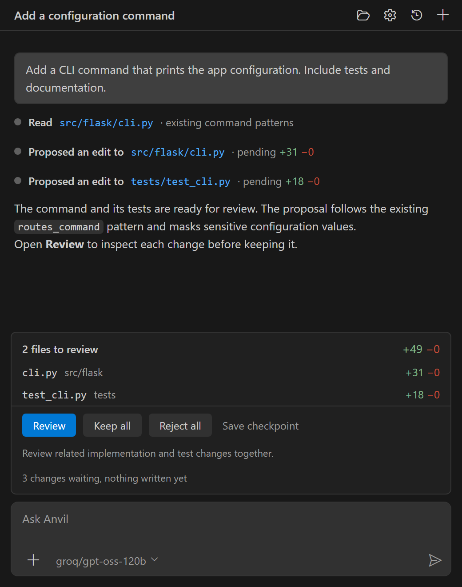
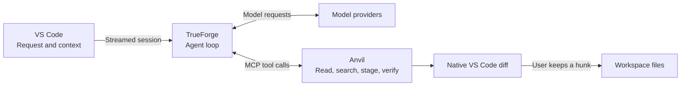

<div align="center">
  <a href="#see-anvil-in-action">
    
  </a>
  <h1>Anvil</h1>
  <p><strong>A VS Code coding agent that shows why it chose each file and lets you decide which edits to keep.</strong></p>
  <p>
    <a href="https://drive.google.com/file/d/1HM96QAkTnalrMM1jFUjyX8wES2yMvt6L/view?usp=sharing"><strong>Watch demo (3:53)</strong></a> &nbsp;?&nbsp;
    <a href="#quick-start"><strong>Quick start</strong></a> &nbsp;·&nbsp;
    <a href="#see-anvil-in-action">Preview</a> &nbsp;·&nbsp;
    <a href="#try-the-flask-demo">Flask demo</a> &nbsp;·&nbsp;
    <a href="docs/writeup.pdf">Write-up PDF</a>
  </p>
  <p>TrueFoundry Forge-a-thon · Techfest IIT Bombay 2026–27</p>
</div>

---

## See Anvil in action

<table>
  <tr>
    <th width="50%" align="left">See what the agent reads</th>
    <th width="50%" align="left">Choose what reaches the workspace</th>
  </tr>
  <tr>
    <td valign="top">
      <a href="docs/assets/anvil-light.png"></a>
    </td>
    <td valign="top">
      <a href="docs/assets/anvil-dark.png"></a>
    </td>
  </tr>
  <tr>
    <td valign="top">Open the Context card to see which files were sent, why they ranked, and how much of the budget they used.</td>
    <td valign="top">Open the native VS Code diff and keep or reject individual hunks. Proposals stay pending until you act.</td>
  </tr>
</table>

<sub>Previews use Anvil’s UI components with example data. Click either image to inspect it at full size.</sub>

**Inline edit** works on a selection. Highlight code, press **Ctrl+I**, and type in the sidebar. A chip shows the selected filename and lines.

**Agent mode** works across files. Ask in the sidebar, follow the plan and tool activity, and click **Stop** to interrupt a turn. You can reopen or delete chats in sidebar History. `/model` switches the current conversation, `/usage` shows reported token totals, and `/rewind` reverses the latest kept edit request after confirmation.

## Quick start

**Requirements** · Node.js **22.18+**, VS Code **1.100+**, Git, and access to a model provider or local Ollama.

### 1. Clone and build

```sh
git clone https://github.com/M-Kushaal/Anvil-x-TrueForge.git anvil
cd anvil
npm ci
npm run build
```

Copy [`.env.example`](.env.example) to `.env` and add your `CEREBRAS_API_KEY` for the default Cerebras setup. Groq and Anthropic keys are also supported. Use `cp .env.example .env` in Bash or `Copy-Item .env.example .env` in PowerShell. Keep your keys in the local `.env` file or in TrueForge.

### 2. Start TrueForge

In **terminal 1**, from the Anvil folder, leave this process running.

```sh
npm run forge
```

It starts TrueForge **0.185.0** at `http://localhost:8790` and the local model relays. Match `anvil.serverUrl` to your server if you use a different address.

### 3. Register the agent and open VS Code

Once TrueForge is listening, run these in **terminal 2**, from the same Anvil folder.

```sh
npm run setup
code --extensionDevelopmentPath=. "/path/to/your/project"
```

`npm run setup` registers the available providers and loads [the Anvil agent definition](agents/anvil.json). Replace the example project path with your workspace. In the Extension Development Host, select **Anvil** in the activity bar.

<details>
<summary><strong>Model selection, Ollama, and Graphify</strong></summary>

- Copy the relevant entries from [example model settings](docs/examples/settings.json) to your workspace’s `.vscode/settings.json`. Use the model names printed by `npm run setup` and order them in `anvil.models`. Anvil selects the first registered model when fallback is enabled. Set `anvil.allowModelFallback` to `false` to use only the first configured model.
- For an API-key-free setup, start Ollama, run `ollama pull qwen2.5:3b`, and run `npm run setup`. Choose the registered Ollama model in `anvil.models`.
- For code-graph context, install Graphify with `pip install graphifyy`. Without it, Anvil retrieves context using lexical matching and code patterns.

</details>

## Try the Flask demo

Clone the competition’s Flask checkout alongside Anvil, then open the **Anvil repository** in VS Code and press **F5**. Select **Run Anvil on fresh Flask** and press **F5**. The launch task uses the sibling repository to create a fresh checkout at `22d92470` under `.cache/debug/`, then opens it in an Extension Development Host. Each launch starts a new test workspace. Complete the TrueForge setup above first.

```sh
git clone --depth 1 --branch 3.1.3 https://github.com/pallets/flask ../flask
```

| Fixed task | What to look for |
| --- | --- |
| **A · Inline edit** | Review a change to Flask’s debug flag, then verify that `FLASK_DEBUG=off` returns `False`. |
| **B · Agent mode** | Ask for a `flask config` command without naming files. Watch Anvil find the implementation, test, and docs, then verify the tests and masked JSON. |
| **C · Resilience** | Repeat the inline request with a deliberately failing provider. Show the error or fallback and verify that the workspace stays clean. |

[Exact prompts, recording sequence, and verification commands](docs/video_plan.md) · [Forge-a-thon write-up](docs/writeup.pdf)

## How it works



TrueForge owns the agent loop. The extension uses the TrueForge SDK for streamed sessions and exposes editor tools over an authenticated loopback MCP connector. Anvil builds the initial context pack from keyword matches, code patterns and optional graph links. The agent can fetch more through tools.

Edits stay in a draft layer until Keep. Commands require explicit approval and run on a temporary workspace copy that includes staged edits, with the user’s host permissions. See [architecture and limitations](docs/architecture.md).

## Develop and verify

| Command | Coverage |
| --- | --- |
| `npm run check` | Typechecking, unit tests, and webview tests |
| `npm run test:e2e` | Review flow inside VS Code |
| `npm run eval` | Retrieval regression on Flask 3.1.3 |
| `npm run test:live` | Live TrueForge sessions and model providers |

The retrieval regression covers **18 expected targets across 8 Flask tasks**, which also informed the retrieval heuristics. See the [development guide](docs/development.md) for fixtures and test prerequisites.

## Team and license

**Never_Gonna_Give_You_Up** | Techfest Team ID **TM-3DD65A68A2F**

**Matam Kushaal** ([GitHub](https://github.com/M-Kushaal)) and **Manit Jhanjharia** ([GitHub](https://github.com/Osama-Bin-Lagging)), IIT Bombay.

**Starting point** · From scratch. TrueForge and the other dependencies are used as libraries and tools. Flask is the demo workspace. Anvil is released under the [MIT license](LICENSE).
