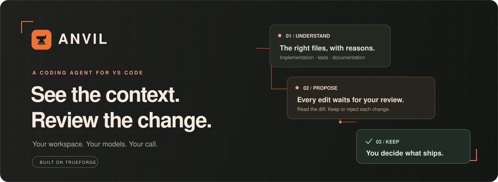
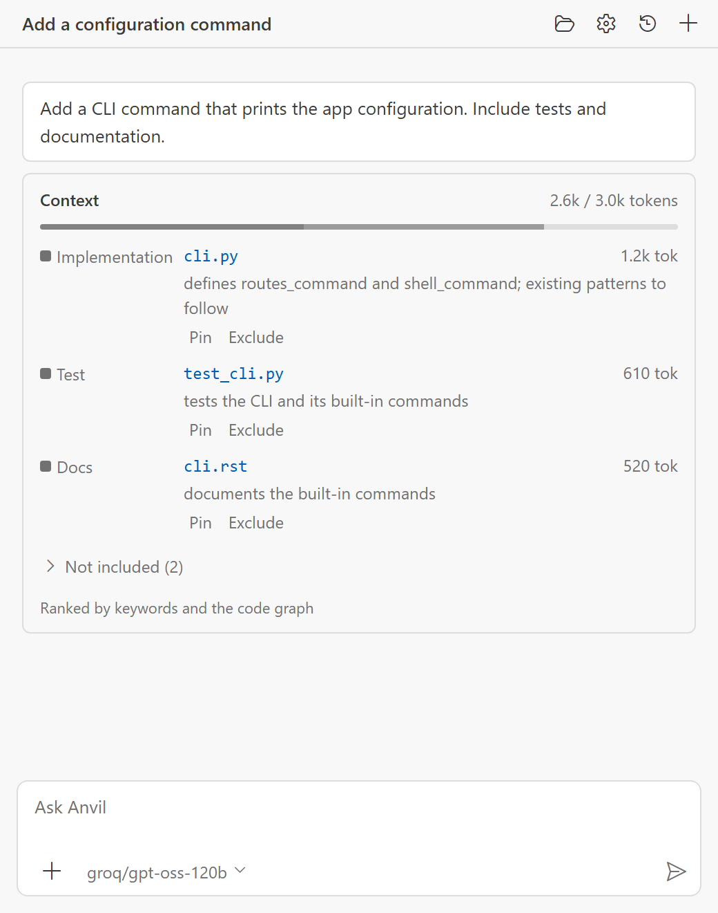
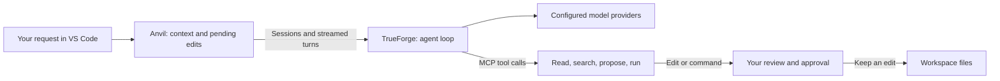

<p align="center">
  
</p>

<h1 align="center">Anvil</h1>

<p align="center">
  <strong>A coding agent that shows its work and puts you in charge of every edit.</strong><br>
  Built for VS Code. Powered by TrueForge. Reviewed by you.
</p>

<p align="center">
  <a href="#quick-start">Quick start</a> &nbsp;·&nbsp;
  <a href="#a-look-inside">Preview</a> &nbsp;·&nbsp;
  <a href="#how-it-works">How it works</a> &nbsp;·&nbsp;
  <a href="docs/development.md">Development</a> &nbsp;·&nbsp;
  <a href="docs/writeup.md">Forge-a-thon write-up</a>
</p>

---

Ask for a small inline edit or a change across your project. Anvil finds relevant code,
explains the context it sends to the model, and stages a proposal. **Your files change
only when you keep the edits.**

Built from scratch for the **TrueFoundry Forge-a-thon · Techfest IIT Bombay 2026–27**
by **Matam Kushaal** and **Manit Jhanjharia**.

## A look inside

<table>
  <tr>
    <td width="50%" align="center"><strong>Understand the context</strong></td>
    <td width="50%" align="center"><strong>Review the proposal</strong></td>
  </tr>
  <tr>
    <td valign="top"></td>
    <td valign="top"></td>
  </tr>
  <tr>
    <td>See which files were selected, why they matter, and how much context they use.</td>
    <td>Follow the work, inspect each diff, and decide which changes reach your files.</td>
  </tr>
</table>

<sub>UI previews rendered from Anvil's Preact components with example data. Light and dark themes follow VS Code.</sub>

## Built around your workflow

| Capability | What you get |
| --- | --- |
| **Inline edits** | Select code, press `Ctrl+I`, and describe the change. The proposal stays within the selection, with a two-line allowance. |
| **Agent mode** | Ask for a task spanning code, tests, and docs. Follow the plan, tool calls, and streamed response in one panel. |
| **Visible context** | Relevant implementation, test, and documentation files, with reasons and a token budget. Pin files or mention `@file` and `@symbol`. |
| **Review before writing** | Keep or reject individual changes in VS Code's diff editor. Run or skip each proposed command. |
| **Recovery** | Reopen chats and recover saved pending proposals. Save and restore checkpoints of proposals before keeping them. |
| **Model fallback** | Retry short interruptions and move through your configured model chain when a provider fails. |

## Quick start

**You need:** Node.js **22.18+**, VS Code **1.100+**, and Git.

```sh
git clone https://github.com/M-Kushaal/Anvil-x-TrueForge.git anvil
cd anvil
npm ci
cp .env.example .env
npm run build
```

Add your `GROQ_API_KEY` to `.env`. An optional `GROQ_SECOND_KEY` enables the second
Groq provider; the example file lists the other supported keys. Keep `.env` local.

Start the backend and relays in **terminal 1**:

```sh
npm run forge
```

Once TrueForge is listening, register the models and agent in **terminal 2**, from
the same `anvil` folder:

```sh
npm run setup
code --extensionDevelopmentPath=. /path/to/your/project
```

Replace `/path/to/your/project` with your workspace. Open **Anvil** in the VS Code
activity bar and send a request. Select code and press **Ctrl+I** for an inline edit.

<details>
<summary><strong>Try the Flask demo with F5</strong></summary>

From the Anvil folder, clone the pinned demo workspace:

```sh
git clone --depth 1 --branch 3.1.3 https://github.com/pallets/flask ../flask
```

Open the Anvil folder in VS Code and press **F5**. The included launch configuration
opens Flask in an Extension Development Host. Try:

> Add a CLI command that prints the app configuration. Mask sensitive values, and include tests and documentation.

To run the Flask evaluation or live tests, see the [development guide](docs/development.md#optional-integration-tests).

</details>

<details>
<summary><strong>Optional: code graphs, local models, and settings</strong></summary>

- Install Graphify with `pip install graphifyy` for code-graph signals. Anvil can retrieve context using keywords when Graphify is unavailable.
- Install Ollama and run `ollama pull qwen2.5:3b` for a local fallback. Start Ollama before `npm run setup`.
- Add providers in TrueForge and configure the chain in `anvil.models`. The first model is primary. Set `anvil.allowModelFallback` to `false` to stay on that model.
- Copy the values you need from [the example settings](docs/examples/settings.json) into your workspace settings.

TrueForge is pinned to **0.185.0**, matching the SDK version Anvil was developed
against. The backend listens on `localhost:8790`; relays use ports `8791` and `8792`.

</details>

## How it works



**TrueForge runs the agent loop.** Anvil supplies editor capabilities as MCP tools,
assembles context, and turns streamed events into a reviewable workflow. The extension
uses the TrueForge SDK; provider requests go through the backend.

**Context has a budget.** Keyword matching, existing code patterns, and optional code
graphs help select relevant implementation, tests, and docs. The agent can read more
through tools when needed.

**Proposals stay pending.** Keep or reject changes hunk by hunk. Commands need approval
and run on a temporary workspace copy with staged edits applied. They retain your host
permissions; this execution mode is not a sandbox.

Read the [architecture guide](docs/architecture.md) for context scoring, tool approvals,
model settings, recovery behavior, and current limitations.

## Develop and verify

```sh
npm run check       # Typechecks + 229 unit/component tests
npm run build       # Development bundles
npm run package     # Production bundles
npm run test:e2e    # Review flow inside a real VS Code instance
```

`npm run eval` checks retrieval against the Flask demo; `npm run test:live` exercises
real TrueForge sessions and model providers. These optional suites have additional
requirements described in the [development guide](docs/development.md).

The retrieval regression covers **18 expected file targets across 8 Flask tasks**.
These tasks helped tune retrieval, so the results are a regression check rather than
a general coding-agent benchmark.

## A few practical boundaries

Provider quotas can interrupt longer runs. Local fallback quality and speed depend
on the model and hardware. Retrieval starts with one file per role; broader changes
rely on the agent reading more. Proposal checkpoints restore pending edits, not files
already kept. See [the full limitations](docs/architecture.md#limitations).

## Team and credits

**Matam Kushaal** · [@M-Kushaal](https://github.com/M-Kushaal)<br>
**Manit Jhanjharia**

Built from scratch; third-party projects are used as libraries and external tools.
Anvil uses **TrueForge SDK**, **Model Context Protocol SDK**, **Preact**, **Graphify**,
**marked**, **DOMPurify**, **jsdiff**, **zod**, and **Codicons**.
See [the submission write-up](docs/writeup.md) for the architecture, model setup,
and Forge-a-thon scorecard.

**MIT licensed** · [LICENSE](LICENSE)
